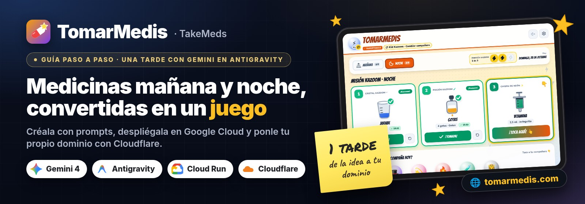

<p align="center">
  
</p>

# Los prompts de TomarMedis, en orden

← [Volver a la guía](README.es.md) · 🇬🇧 [English](PROMPTS.md)

Estos son los prompts que usamos con Gemini en Antigravity, en el orden en que los usamos. Cópialos y cambia los `<MARCADORES>` por lo tuyo. Cada paso dice qué comprobar antes de pasar al siguiente.

**Cómo usarlos**

- Trabaja en una carpeta local normal. Pide al agente un plan antes de empezar y revisa los cambios que propone.
- Pídele que **compruebe** lo que hace, en vez de fiarte del resumen:
  - typecheck y build;
  - capturas con un navegador automático;
  - `curl` contra la URL publicada.
- No pegues claves ni datos de salud reales en los prompts. El nombre del peque y sus medicinas se configuran después, en el propio dispositivo.

**Índice:** [Brief visual](#brief-visual) · [0](#paso-0) · [1](#paso-1) · [2](#paso-2) · [3](#paso-3) · [4](#paso-4) · [5](#paso-5) · [6](#paso-6) · [7](#paso-7) · [8](#paso-8) · [9](#paso-9) · [Extra](#extra)

---

<a id="brief-visual"></a>

## Brief visual (pégalo al final del prompt 1)

Para que la app salga con el mismo aspecto que la nuestra (puedes ver capturas en la [guía](README.es.md#como-se-usa)):

```text
Aspecto: primero iPad en horizontal y también en vertical. Botones grandes (mínimo 64 px),
mucho contraste y pocas palabras.
- Cabecera: avatar redondo del compañero, el nombre de la app con la tipografía del tema, una
  píldora con el nombre del mundo y un botón "<compañero> · Cambiar compañero". A la derecha,
  sonido y un engranaje para la zona de padres.
- Debajo: píldoras con las tomas del día ("Mañana 0/3", "Noche 0/3"), un contador de placas
  del tema con 3 huecos que se van llenando y la fecha de hoy.
- Un título de misión del tema ("Misión de rescate · Noche").
- Una tarjeta grande por medicina con:
  - número y nombre de la placa del tema;
  - un dibujo grande (vasito medidor, gotero o jeringuilla oral);
  - nombre, dosis y forma ("5 ml · Vasito");
  - un botón con degradado "¡Toca aquí! 👆".
  Al tomarla: check verde, la hora, un botón "¡Tomada!" y deshacer. Una mano animada señala
  la siguiente tarjeta.
- Abajo, una fila con los compañeros del mundo (avatar con emoji en un círculo de color), con
  el elegido marcado.
- Al completar la toma: un banner del tema con el botón "Ver mi vídeo" y una celebración con
  confeti antes del vídeo.
- Zona de padres en una ventana con pestañas (General, Tema, Medicinas, Horario, Premios,
  Sonido, Datos), detrás de una suma sencilla para mayores.
- Cada mundo cambia la paleta, la tipografía (Google Fonts), el fondo y los sonidos. El resto
  de la interfaz es igual en todos.
```

<a id="paso-0"></a>

## 0. Prototipo rápido (opcional, Google AI Studio → Build)

```text
Crea una web divertida para que mi peque de <EDAD> años se tome sus medicinas por la mañana y
por la noche. Tarjetas grandes y fáciles de tocar para cada medicina (nombre, dosis, dibujo de
un vasito medidor o de una jeringuilla oral), un selector sol/luna, un calendario semanal con
estrellas, un personaje que le anima con voz y un vídeo de premio cuando se toma todas.
Interfaz en español, pensada para iPad.
```

✅ **Comprueba:** que el peque entiende qué tiene que tocar sin que se lo expliques. Descarga el zip para el paso 1.

<a id="paso-1"></a>

## 1. Convertir el prototipo en un proyecto de verdad

Abre Antigravity en una carpeta nueva, adjunta el zip del prototipo y pide (añade al final el [brief visual](#brief-visual)):

```text
Esto es un prototipo de una app de rutina de medicinas para niños hecho en AI Studio.
Conviértelo en un proyecto profesional, listo para desplegar en Google Cloud.

Temas: <LAS 6 SERIES FAVORITAS DE TU PEQUE>. Cada tema con su paleta, tipografía, fondo
animado, efectos de sonido y de 4 a 8 personajes con frases propias en español e inglés.

Flujo: el peque elige compañero, toca cada medicina al tomarla (el personaje le anima) y al
completar la toma gana UN vídeo oficial de 2 a 5 minutos (normalmente ~3) de esa serie, con un
botón de "otro vídeo" que prioriza los que aún no ha visto.

Zona de padres con control para mayores: nombre del peque, idioma, tema, de 1 a 10 medicinas
(nombre, dosis/tamaño, cómo se toma, color, en qué tomas), horarios predefinidos (mañana y noche,
una vez al día, cada 12/8/6 horas, horas personalizadas), límites de premios, sonido, copia de
seguridad y enlace para configurar otro dispositivo.

Voces naturales: un endpoint en el servidor con Google Cloud Text-to-Speech (Gemini-TTS) con una
voz y un prompt de estilo por personaje, con caché; si falla, voz del dispositivo.

Stack: React + Vite + TypeScript + Tailwind, un servidor Node/Express pequeño que sirve la app y
las APIs, y un Dockerfile para Cloud Run. Todo configurable con variables de entorno. Nada de
secretos ni datos personales en el repositorio.

Trabaja en una carpeta local nueva. Enséñame primero el plan, después constrúyelo y pasa un
typecheck y una prueba con navegador automático con capturas en iPad horizontal y vertical.
```

Nosotros usamos seis mundos: La Patrulla Canina, SuperThings, Frozen, Toy Story, El Rey León y Wish.

✅ **Comprueba:**
- typecheck y build sin errores;
- capturas en iPad horizontal y vertical;
- que el recorrido completo funciona: elegir compañero, tocar las medicinas y llegar al premio.

<a id="paso-2"></a>

## 2. Solo vídeos oficiales

```text
Investiga los canales oficiales de YouTube de cada serie (<SERIES>) en español de España y en
inglés. Verifica cada id de canal desde su página. Crea una lista de vídeos oficiales que se
puedan incrustar, de 120 a 300 segundos, verificados con oEmbed y con la página del vídeo,
etiquetados por personaje. No te inventes ningún id.

Después añade un endpoint que busque SOLO dentro de esos canales con la YouTube Data API
(safeSearch estricto, incrustables, de 90 a 300 s, teniendo en cuenta el país, títulos que sean
claramente del tema, sin tráilers, sin subidas de solo audio, sin "making of"), con caché de 12
horas y la lista verificada como respaldo. En el reproductor, limita la duración máxima y salta
cualquier vídeo que no cargue.
```

✅ **Comprueba:** pídele la tabla con cada vídeo y cómo lo ha verificado. Después, que «otro vídeo» no repite los que ya ha visto.

<a id="paso-3"></a>

## 3. Imágenes de personajes sin publicar material gráfico

```text
No subas ningún material gráfico oficial. Por defecto cada personaje muestra un avatar con emoji.
Añade (1) subir foto o URL por dispositivo desde la zona de padres y (2) una variable
THEME_OVERRIDES_JSON en el servidor con una URL de imagen por personaje, que solo se sirva a los
dispositivos que han metido el código familiar.
```

✅ **Comprueba:** que no hay imágenes oficiales en el proyecto y que una foto subida desde la zona de padres aparece en el avatar.

<a id="paso-4"></a>

## 4. Voces que suenen a personaje

```text
Asigna a cada personaje una voz de Gemini-TTS y un prompt de estilo corto (por ejemplo "un
muñeco de nieve gracioso y tierno al que le encantan los abrazos calentitos"). Precarga las
frases que dirá el compañero elegido y los saludos de los demás, guarda el audio en caché en el
servidor y en el dispositivo (Cache Storage) y reprodúcelo con Web Audio para que Safari en el
iPad no lo bloquee.
```

✅ **Comprueba**, en el iPad de verdad:
- cada personaje suena distinto;
- la segunda vez, la frase suena al instante.

<a id="paso-5"></a>

## 5. Desplegar en Google Cloud Run

Antes, entra con `gcloud auth login` y elige un proyecto con facturación activa.

```text
Escribe deploy/deploy-cloud-run.sh que lea PROJECT_ID y REGION del entorno, active las APIs
necesarias, cree una cuenta de servicio con roles/aiplatform.user (la necesita Gemini-TTS),
guarde en Secret Manager un ACCESS_CODE familiar, una clave opcional de YouTube y los ajustes
de tema, y despliegue con `gcloud run deploy --source` (escala a cero, máximo 2 instancias, URL
pública).

Después despliégalo en el proyecto <PROJECT_ID> en <REGION> y comprueba en la URL publicada:
health check, login con el código familiar, una petición de voz y una búsqueda de vídeos.
```

✅ **Comprueba:** que la URL `https://<servicio>-<número>.<región>.run.app` abre en el iPad. Lee cada comando antes de aprobarlo.

<a id="paso-6"></a>

## 6. Un código familiar que no estorbe

```text
Cuando el servidor tenga código familiar, muestra una pantalla con dos botones del mismo tamaño:
"Entrar con código" y "Continuar sin código". Recuerda la elección en el dispositivo y deja que
los padres metan el código más tarde desde la zona de padres. Cambia el código a <NUEVO_CODIGO>.
```

✅ **Comprueba:**
- los dos botones miden lo mismo;
- sin código, la app funciona con la voz del dispositivo;
- con código, se activan las voces naturales y la búsqueda de vídeos.

<a id="paso-7"></a>

## 7. Que el peque pueda cambiar de compañero cuando quiera

```text
En la pantalla principal, añade una fila siempre visible con los compañeros del tema (un toque
para cambiar y el nuevo le saluda) y un botón claro de "cambiar compañero" en la cabecera.
```

✅ **Comprueba:** que un toque cambia el compañero y el nuevo saluda.

<a id="paso-8"></a>

## 8. Dominio propio con Cloudflare

Compra el dominio en Cloudflare y pide (los detalles están en la [guía](README.es.md#dominio)):

```text
He comprado <DOMINIO> en Cloudflare. Ayúdame a verificarlo con la cuenta de Google dueña del
proyecto de Cloud Run, conecta <DOMINIO> y www.<DOMINIO> al servicio, dime exactamente qué
registros DNS poner en Cloudflare (solo DNS, sin proxy), redirige www al dominio raíz y vigila
hasta que se emitan los certificados.
```

✅ **Comprueba:**
- `https://<DOMINIO>` abre con el candado;
- `www` redirige al dominio raíz;
- `gcloud beta run domain-mappings describe` da el certificado por emitido.

<a id="paso-9"></a>

## 9. Nombre y últimos detalles

```text
Cambia el nombre de la app a <NOMBRE> (<NOMBRE_EN_INGLÉS> en inglés) en la interfaz, el
manifiesto de la PWA y los textos, sin cambiar las claves internas de almacenamiento. Revisa
que no quede ninguna clave ni dato personal en el proyecto y deja un README con cómo
arrancarla en local y cómo desplegarla.
```

✅ **Comprueba:**
- el nombre nuevo sale en la pestaña, en el icono del iPad y en los textos;
- los datos que ya tenía el iPad siguen ahí.

<a id="extra"></a>

## Extra: comparte cómo lo hiciste

Así preparamos este repositorio:

```text
Escribe una guía paso a paso de cómo hemos construido esta app: qué pedimos, en qué orden,
cómo la desplegamos y cómo conectamos el dominio, con los prompts que hemos usado y capturas
con datos de ejemplo. Sin código, sin claves y sin datos personales.
```

---

¿Algo no sale a la primera? Mira los [tropiezos que tuvimos](README.es.md#tropiezos).
