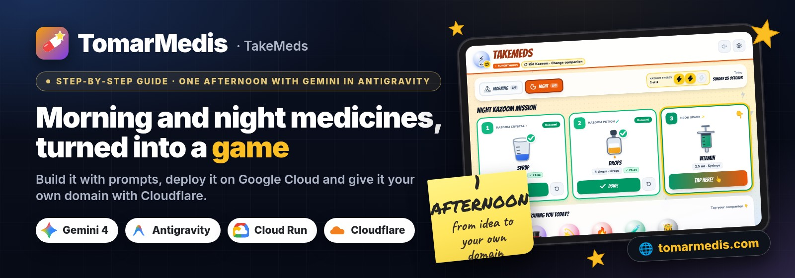

<p align="center">
  
</p>

# The TomarMedis prompts, in order

← [Back to the guide](README.md) · 🇪🇸 [Español](PROMPTS.es.md)

These are the prompts we used with Gemini in Antigravity, in the order we used them. Copy them and replace the `<PLACEHOLDERS>` with your own values. Each step says what to check before moving on.

**How to use them**

- Work in a normal local folder. Ask the agent for a plan before it starts, and review the changes it proposes.
- Ask it to **verify** its work instead of trusting the summary:
  - typecheck and build;
  - screenshots from a headless browser;
  - `curl` against the live URL.
- Don't paste API keys or real health data into the prompts. The kid's name and medicines are set later, on the device itself.

**Index:** [Visual brief](#visual-brief) · [0](#step-0) · [1](#step-1) · [2](#step-2) · [3](#step-3) · [4](#step-4) · [5](#step-5) · [6](#step-6) · [7](#step-7) · [8](#step-8) · [9](#step-9) · [Bonus](#bonus)

---

<a id="visual-brief"></a>

## Visual brief (paste it at the end of prompt 1)

This makes the app come out with the same look as ours. The [guide](README.md#how-its-used) has screenshots.

```text
Look and feel: iPad landscape first, portrait too. Big tap targets (at least 64 px), high
contrast and few words.
- Header: the companion's round avatar, the app name in the theme's display font, a pill with
  the world's name and a "<companion> · Change companion" button. Sound and a gear icon for
  the parents zone on the right.
- Below it: pills for today's doses ("Morning 0/3", "Night 0/3"), a themed badge counter with
  3 slots that fill up, and today's date.
- A themed mission title ("Night rescue mission").
- One big card per medicine with:
  - number and themed badge name;
  - a large drawing (measuring cup, dropper or oral syringe);
  - name, dose and form ("5 ml · Cup");
  - a gradient "Tap here! 👆" button.
  Once taken: green check, the time, a "Done!" button and undo. An animated hand points at
  the next card.
- At the bottom, a row with the world's companions (emoji avatar on a coloured circle), with
  the selected one ticked.
- When the dose is complete: a themed banner with a "Watch my video" button and a confetti
  celebration before the video.
- Parents zone in a dialog with tabs (General, Theme, Medicines, Schedule, Rewards, Sound,
  Data), behind a simple grown-up sum.
- Each world changes the palette, display font (Google Fonts), background and sounds. The
  rest of the interface is the same in every world.
```

<a id="step-0"></a>

## 0. Quick prototype (optional, Google AI Studio → Build)

```text
Create a fun web app so my <AGE>-year-old can take their medicines every morning and night.
Big touch-friendly cards for each medicine (name, dose, a drawing of a measuring cup or an
oral syringe), a sun/moon switch, a weekly calendar with stars, a companion character that
cheers them on with a voice, and a reward video when all the doses are taken.
<LANGUAGE> UI, designed for an iPad.
```

✅ **Check** that your kid understands what to tap without being told. Download the zip for step 1.

<a id="step-1"></a>

## 1. Turn the prototype into a real project

Open Antigravity in a new folder, attach the prototype zip and ask (add the [visual brief](#visual-brief) at the end):

```text
This is a prototype of a kids' medicine routine app made in AI Studio. Turn it into a
professional project, ready to deploy on Google Cloud.

Themes: <YOUR KID'S 6 FAVOURITE SHOWS>. Each theme has its own palette, display font, animated
background, sound effects and 4-8 characters with their own lines in Spanish and English.

Flow: the child picks a companion, taps each medicine as it is taken (the character cheers),
and when the dose is complete earns ONE official video of 2-5 minutes (mostly ~3) from that
show, with a "watch another" button that prefers videos not watched yet.

Parents zone behind a grown-up check: child name, language, theme, 1-10 medicines (name,
dose/size, how it is taken, colour, which doses), schedule presets (morning & night, once a
day, every 12/8/6 hours, custom times), reward limits, sound, backup/restore and a setup link
to configure another device.

Natural voices: a server endpoint that uses Google Cloud Text-to-Speech (Gemini-TTS) with a
voice and a style prompt per character, cached; fall back to the device voice.

Stack: React + Vite + TypeScript + Tailwind, a small Node/Express server that serves the app
and the APIs, and a Dockerfile for Cloud Run. Everything configurable through environment
variables. No secrets and no personal data in the repo.

Work in a new local folder. Show me the plan first, then build it, run a typecheck and a
headless-browser smoke test with screenshots for iPad landscape and portrait.
```

We used six worlds: PAW Patrol, SuperThings, Frozen, Toy Story, The Lion King and Wish.

✅ **Check:**
- typecheck and build pass;
- there are screenshots for iPad landscape and portrait;
- the whole journey works: pick a buddy, tap the medicines, get to the reward.

<a id="step-2"></a>

## 2. Official videos only

```text
Research the official YouTube channels of each show (<SHOWS>) for Spanish (Spain) and English.
Verify every channel id from its handle page. Build a curated list of embeddable official
videos between 120 and 300 seconds, verified with oEmbed and the watch page, tagged by
character. Never invent video ids.

Then add a server endpoint that searches ONLY inside those channels with the YouTube Data API
(safeSearch strict, embeddable, 90-300 s, region aware, titles that clearly belong to the theme,
no trailers, no audio-only uploads, no making-of), cached for 12 hours, with the curated list
as fallback. In the player, enforce the maximum length and skip any video that fails to load.
```

✅ **Check:** ask for the table of videos and how each one was verified. Then make sure "watch another" doesn't repeat videos already watched.

<a id="step-3"></a>

## 3. Character pictures without shipping artwork

```text
Do not commit any official artwork. Characters show a friendly emoji avatar by default.
Add (1) per-device picture upload or URL in the parents zone and (2) a THEME_OVERRIDES_JSON
server setting with an image URL per character, served only to devices that entered the
family code.
```

✅ **Check** that there's no official artwork in the project, and that a photo uploaded from the parents zone shows up in the avatar.

<a id="step-4"></a>

## 4. Voices that feel like characters

```text
Give each character a Gemini-TTS voice and a short style prompt (for example "a goofy, warm
little snowman who loves warm hugs"). Prefetch the lines the selected companion will say and
the greetings of the others, cache the audio on the server and on the device (Cache Storage),
and play it through Web Audio so iPad Safari does not block it.
```

✅ **Check** on a real iPad:
- every character sounds different;
- the second time, a line plays instantly.

<a id="step-5"></a>

## 5. Deploy to Google Cloud Run

First run `gcloud auth login` and pick a project with billing enabled.

```text
Write deploy/deploy-cloud-run.sh that reads PROJECT_ID and REGION from the environment,
enables the required APIs, creates a runtime service account with roles/aiplatform.user
(needed for Gemini-TTS), stores a family ACCESS_CODE, an optional YouTube API key and the theme
overrides in Secret Manager, and deploys with `gcloud run deploy --source` (scale to zero,
max 2 instances, public URL).

Then deploy it to project <PROJECT_ID> in <REGION> and verify on the live URL: health check,
login with the family code, a TTS request and a video search.
```

✅ **Check** that `https://<service>-<number>.<region>.run.app` opens on the iPad. Read every command before you approve it.

<a id="step-6"></a>

## 6. A family code that doesn't get in the way

```text
When the server has a family code, show a screen with two buttons of the same size:
"Enter with code" and "Continue without code". Remember the choice on the device and let
parents enter the code later from the parents zone. Change the code to <NEW_CODE>.
```

✅ **Check:**
- both buttons are the same size;
- without the code, the app works with the device voice;
- with the code, natural voices and video search are switched on.

<a id="step-7"></a>

## 7. Let the kid switch buddy any time

```text
On the main screen, add an always-visible row with the companions of the current theme
(one tap to switch, the new one greets the child) and a clear "change companion" button in the
header.
```

✅ **Check** that one tap switches the buddy and the new one says hello.

<a id="step-8"></a>

## 8. Your own domain with Cloudflare

Buy the domain at Cloudflare, then ask (the details are in the [guide](README.md#domain)):

```text
I bought <DOMAIN> at Cloudflare. Help me verify it for the Google account that owns the Cloud
Run project, map <DOMAIN> and www.<DOMAIN> to the service, tell me the exact DNS records to add
in Cloudflare (DNS only, no proxy), redirect www to the root domain and monitor until the
certificates are issued.
```

✅ **Check:**
- `https://<DOMAIN>` opens with the padlock;
- `www` redirects to the root domain;
- `gcloud beta run domain-mappings describe` shows the certificate as issued.

<a id="step-9"></a>

## 9. Name and polish

```text
Rename the app to <NAME> (<ENGLISH_NAME> in English) in the UI, the PWA manifest and the
texts, without changing internal storage keys. Check that no keys or personal data are left in
the project, and write a README with how to run it locally and how to deploy it.
```

✅ **Check:**
- the new name shows in the tab, on the iPad icon and in the texts;
- the data already on the iPad is still there.

<a id="bonus"></a>

## Bonus: share how you built it

This is how we prepared this repository:

```text
Write a step-by-step guide to how we built this app: what we asked for, in which order, how we
deployed it and how we connected the domain, with the prompts we used and screenshots with
sample data. No code, no keys and no personal data.
```

---

Something not working the first time? See the [gotchas we hit](README.md#gotchas).
