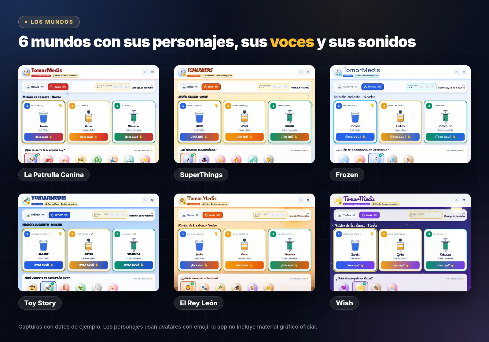
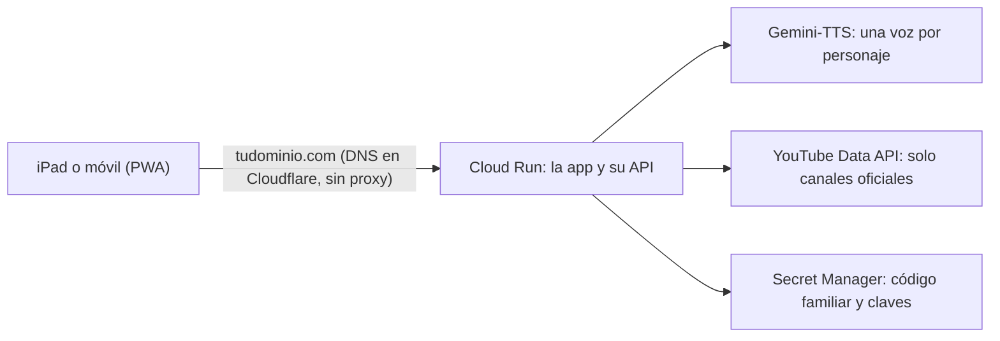
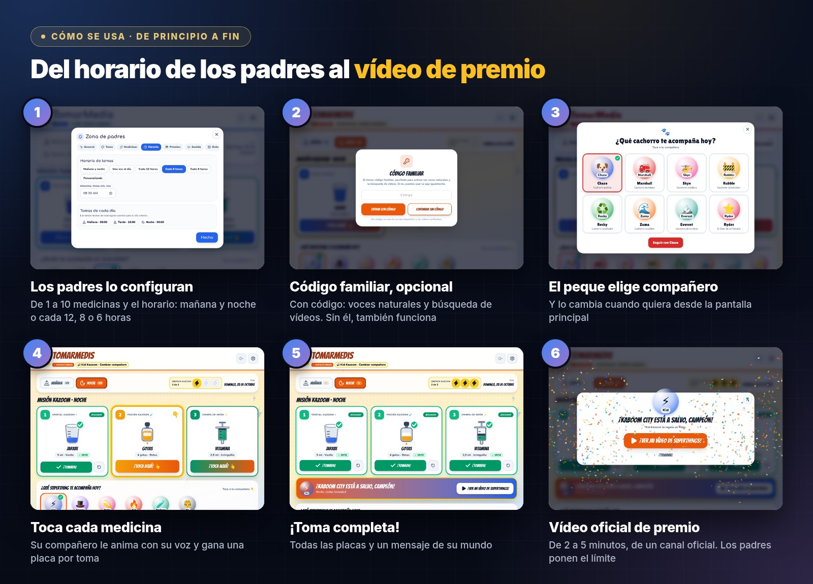
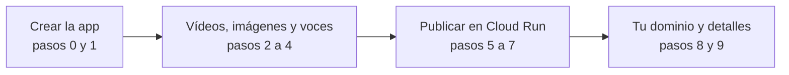

<p align="center">
  
</p>

<p align="center">
  🌐 <a href="https://tomarmedis.com"><b>Pruébala en tomarmedis.com</b></a> ·
  💬 <a href="PROMPTS.es.md"><b>Todos los prompts</b></a> ·
  🇬🇧 <a href="README.md">English</a>
</p>

# Cómo hacer TomarMedis en una tarde con Gemini en Antigravity

En casa nos ha tocado acostumbrarnos a tomar medicinas por la mañana y por la noche, y va para largo. Así que una tarde, entre todos y con **Gemini en [Google Antigravity](https://antigravity.google/)**, hicimos **TomarMedis** (*TakeMeds* en inglés): una app para que el peque se las tome jugando y coja la rutina rápido. La publicamos en **Google Cloud Run** y le pusimos dominio propio con **Cloudflare**.

Este repositorio **no incluye el código de la app**. Incluye el proceso: qué le pedimos al agente y en qué orden, cómo la desplegamos y cómo conectamos el dominio. Con esto puedes hacer la tuya, con los personajes favoritos de tu casa.

> [!TIP]
> ¿Con prisa? Ve directo a [la tarde, paso a paso](#la-tarde) y copia los prompts de [PROMPTS.es.md](PROMPTS.es.md).

**Contenido**

1. [Qué vas a construir](#que-vas-a-construir)
2. [Cómo se usa](#como-se-usa)
3. [Qué necesitas](#que-necesitas)
4. [La tarde, paso a paso](#la-tarde)
5. [Tu dominio con Cloudflare](#dominio)
6. [Tropiezos que tuvimos](#tropiezos)
7. [Cómo pedirle las cosas al agente](#consejos)
8. [Aviso y licencia](#aviso)

<a id="que-vas-a-construir"></a>

## 1. Qué vas a construir

| | |
| --- | --- |
| **Tipo de app** | Web app instalable (PWA). Pensada para un iPad en la cocina, funciona en cualquier navegador moderno |
| **Para quién** | Peques de 3 a 8 años, que tocan, escuchan y ganan, y sus padres, que la configuran |
| **Qué resuelve** | Cada toma (mañana y noche, o cada 12, 8 o 6 horas) se convierte en una misión con personajes, voces y un vídeo de premio |
| **Idiomas** | Español e inglés |
| **Datos** | Se quedan en el dispositivo: sin cuentas ni base de datos |
| **Lo que generará Gemini** | React + Vite + TypeScript + Tailwind, un servidor Node/Express pequeño y un Dockerfile |
| **En Google Cloud** | Cloud Run (escala a cero), Gemini-TTS para las voces, Secret Manager y Cloud Build. Opcional: YouTube Data API |
| **Dominio** | Comprado en Cloudflare y conectado con el mapeo de dominios de Cloud Run |

<p align="center">
  
</p>

Así encaja todo una vez publicada:



<a id="como-se-usa"></a>

## 2. Cómo se usa

<p align="center">
  
</p>

1. **Los padres la configuran** en la zona de padres, protegida con una suma sencilla:
   - nombre del peque, idioma y mundo;
   - de 1 a 10 medicinas, cada una con su nombre, su dosis y cómo se toma (vasito, gotas o jeringuilla);
   - el horario: mañana y noche, una vez al día, cada 12, 8 o 6 horas, o a medida.
2. **Código familiar, opcional.**
   - Con el código se activan las voces naturales y la búsqueda de vídeos.
   - Con «Continuar sin código», la app usa la voz del dispositivo y una lista de vídeos ya verificados.
3. **El peque elige compañero**, y puede cambiarlo cuando quiera desde la pantalla principal.
4. **Toca cada medicina al tomarla** («¡Toca aquí!»). Su compañero le anima con su voz y gana una placa por toma.
5. **Toma completa:** un mensaje de su mundo y una celebración con confeti.
6. **Premio:** un vídeo de 2 a 5 minutos de un canal oficial de su serie. Un botón de «otro vídeo» prioriza los que aún no ha visto, y los padres ponen el límite.

Además:
- calendario semanal con rachas;
- deshacer una toma marcada por error;
- copia de seguridad;
- un enlace para configurar otro dispositivo de un toque.

<a id="que-necesitas"></a>

## 3. Qué necesitas

- **[Google Antigravity](https://antigravity.google/)** con Gemini (nosotros usamos Gemini 4).
- **Una cuenta de Google Cloud** con facturación activa y un proyecto. Instala la [gcloud CLI](https://cloud.google.com/sdk/docs/install) y entra con `gcloud auth login`: el agente la usará desde el terminal y te pedirá permiso antes de cada comando.
- **Opcional:** [Google AI Studio](https://aistudio.google.com/) para el prototipo inicial.
- **Opcional:** una clave de la YouTube Data API v3, para buscar vídeos nuevos dentro de los canales oficiales.
- **Opcional:** un dominio. Nosotros lo compramos en Cloudflare: un .com cuesta unos 10-15 € al año.
- Una tarde (unas 3 o 4 horas) y alguien de la casa que pruebe cada cambio en el iPad 😉

<a id="la-tarde"></a>

## 4. La tarde, paso a paso



| Paso | Qué le pides al agente | Tiempo aprox. | Lo que tienes al acabar |
| --- | --- | --- | --- |
| [0](PROMPTS.es.md#paso-0) | Prototipo rápido en AI Studio (opcional) | 15 min | Una primera versión para enseñar en casa |
| [1](PROMPTS.es.md#paso-1) | Convertirlo en un proyecto de verdad | 45-60 min | La app completa en tu ordenador, con sus mundos |
| [2](PROMPTS.es.md#paso-2) | Solo vídeos oficiales | 20 min | Premios de canales oficiales, verificados uno a uno |
| [3](PROMPTS.es.md#paso-3) | Imágenes de personajes sin publicar material gráfico | 10 min | Avatares con emoji y fotos solo en tu dispositivo |
| [4](PROMPTS.es.md#paso-4) | Voces de personaje con Gemini-TTS | 20 min | Cada compañero con su voz |
| [5](PROMPTS.es.md#paso-5) | Desplegar en Cloud Run | 20 min | Una URL pública con HTTPS |
| [6](PROMPTS.es.md#paso-6) | Un código familiar que no estorbe | 10 min | Lo que cuesta dinero, protegido |
| [7](PROMPTS.es.md#paso-7) | Cambiar de compañero cuando quiera | 10 min | El peque decide con quién juega |
| [8](PROMPTS.es.md#paso-8) | Dominio propio con Cloudflare | 30 min + espera | `tudominio.com` con HTTPS |
| [9](PROMPTS.es.md#paso-9) | Nombre y últimos detalles | 15 min | Lista para usar a diario |

### 0. Prototipo rápido (opcional)

En AI Studio, entra en **Build** y describe la app con tus palabras. Sirve para enseñarla en casa y decidir qué quieres antes de ponerte en serio. Descarga el zip: lo usarás en el paso 1.

### 1. El proyecto de verdad en Antigravity

1. Abre Antigravity en una carpeta local vacía y adjunta el zip del prototipo.
2. Pega el prompt 1 junto con el [brief visual](PROMPTS.es.md#brief-visual), para que salga con el mismo aspecto.
3. Pide el plan primero y revísalo.
4. Después, que lo construya y lo pruebe solo: typecheck, build y capturas con un navegador automático en iPad horizontal y vertical.

✅ Comprueba que puedes hacer el recorrido completo: elegir compañero, tocar las medicinas y llegar al premio.

### 2 a 4. Vídeos, imágenes y voces

Tres prompts cortos, uno detrás de otro:

- **Vídeos:** el agente busca los canales oficiales de cada serie y comprueba cada vídeo antes de añadirlo. Las búsquedas nuevas solo miran dentro de esos canales, y le pedimos que no se invente ningún vídeo.
- **Imágenes:** la app no incluye material gráfico oficial. Por defecto salen avatares con emoji, y las fotos las pones tú en tu dispositivo o en tu despliegue.
- **Voces:** cada personaje tiene una voz de Gemini-TTS y un prompt de estilo. Las frases se guardan en caché para que suenen al instante y no se paguen dos veces.

✅ Escucha las voces en el iPad de verdad: Safari solo deja sonar audio después del primer toque.

### 5. Desplegar en Google Cloud Run

Con el prompt 5, el agente escribe un script de despliegue y lo ejecuta en tu proyecto. Te pedirá permiso para cada comando, y esto es lo que hace:

1. Activar las APIs: Cloud Run, Cloud Build, Artifact Registry, Secret Manager, Text-to-Speech y, si la usas, YouTube Data API.
2. Crear una cuenta de servicio solo para la app, con `roles/aiplatform.user` (Gemini-TTS lo necesita) y acceso a sus secretos.
3. Guardar en Secret Manager el código familiar, la clave de YouTube y los ajustes de los mundos.
4. Construir y desplegar con `gcloud run deploy --source`: escala a cero, máximo 2 instancias y URL pública.
5. Probar la URL publicada: que responde, que entra con el código, que genera una voz y que encuentra vídeos.

✅ Abre en el iPad la URL `https://<servicio>-<número>.<región>.run.app`.

### 6 y 7. Código familiar y compañeros

- **Código familiar:** una pantalla con dos botones del mismo tamaño, «Entrar con código» y «Continuar sin código». Protege lo que cuesta dinero (las voces y la búsqueda de vídeos) sin dejar fuera a nadie.
- **Compañeros:** una fila siempre visible para cambiar de personaje con un toque. El nuevo le saluda.

### 8. Tu dominio

Lo contamos con detalle en la [siguiente sección](#dominio).

### 9. Nombre y últimos detalles

1. Ponle nombre en los dos idiomas (nosotros: TomarMedis y TakeMeds).
2. Revisa los textos con el peque.
3. Instálala en el iPad desde Safari: **Compartir → Añadir a pantalla de inicio**. Así se abre a pantalla completa y Safari no borra sus datos.

<a id="dominio"></a>

## 5. Tu dominio con Cloudflare

Esto es lo que hicimos para tener `tomarmedis.com`. Puedes hacerlo a mano o pedírselo al agente con el [prompt 8](PROMPTS.es.md#paso-8). En los dos casos, la parte de Cloudflare la haces tú.

1. **Compra el dominio** en Cloudflare: *Domain Registration → Register Domains*. Cloudflare te gestiona el DNS desde el primer momento.
2. **Verifica que es tuyo** con la cuenta de Google dueña del proyecto de Cloud Run:

   ```bash
   gcloud domains verify tudominio.com
   ```

   Se abre Search Console:
   - Elige verificar por DNS.
   - Si Cloudflare aparece en la lista, pulsa **Iniciar verificación** y autoriza.
   - Si no aparece, crea en Cloudflare un registro `TXT` con nombre `@` y el valor `google-site-verification=…`.
   - Pulsa **Verificar**.

   > [!NOTE]
   > Da igual con qué cuenta compraste el dominio (nosotros, con una cuenta personal). Lo que importa es que la cuenta de Google del proyecto figure como **propietaria** en Search Console. Si ya lo verificaste con otra cuenta, añádela como propietaria.

3. **Conecta el dominio al servicio**, y también `www` si lo quieres:

   ```bash
   gcloud beta run domain-mappings create --service <SERVICIO> --domain tudominio.com --region <REGION>
   gcloud beta run domain-mappings create --service <SERVICIO> --domain www.tudominio.com --region <REGION>
   ```

4. **Añade los registros DNS** que te da `gcloud beta run domain-mappings describe --domain tudominio.com --region <REGION>`.
   - En Cloudflare: *DNS → Records → Add record*.
   - **Proxy status: DNS only** (nube gris) y TTL Auto.
   - A nosotros nos dio estos:

   | Tipo | Nombre | Contenido |
   | --- | --- | --- |
   | A (4 registros) | `@` | `216.239.32.21`, `216.239.34.21`, `216.239.36.21`, `216.239.38.21` |
   | AAAA (4 registros) | `@` | `2001:4860:4802:32::15`, `2001:4860:4802:34::15`, `2001:4860:4802:36::15`, `2001:4860:4802:38::15` |
   | CNAME | `www` | `ghs.googlehosted.com` |

   No borres el `TXT` de verificación: Google lo vuelve a comprobar de vez en cuando.

5. **Espera el certificado HTTPS.** Google lo emite solo, normalmente en menos de una hora y como mucho en 24 h. Mientras tanto, `https://tudominio.com` puede dar error de certificado: es normal.
6. **Redirige `www` al dominio raíz** para que el iPad use siempre la misma dirección. Pídeselo al agente; nosotros lo hicimos con una variable, `CANONICAL_HOST`.
7. **Pasa el iPad a la nueva dirección.** Cada dirección web guarda sus propios datos. Haz una copia en la antigua (Zona de padres → Datos) y restáurala en la nueva, o usa el enlace de configuración.

> [!WARNING]
> Si dejas los registros en **Proxied** (nube naranja), Google no puede emitir el certificado y el dominio no llega a funcionar. Nos pasó, y se arregló al cambiar los 9 registros a *DNS only*.

> [!NOTE]
> El mapeo de dominios de Cloud Run está en *Preview* y solo existe en algunas regiones (`europe-west1` sí). Para una app familiar va de sobra. Si tu región no lo tiene, la alternativa es un balanceador de carga.

<a id="tropiezos"></a>

## 6. Tropiezos que tuvimos

- **Gemini-TTS a través de Cloud Text-to-Speech** necesita `aiplatform.endpoints.predict` en la cuenta de servicio (`roles/aiplatform.user`). Sin ese permiso, el servidor pasa a otra voz (Chirp 3 HD) sin avisar.
- **Safari en el iPad:**
  - desbloquea el audio con el primer toque;
  - usa `playsinline` en YouTube;
  - añade la app a la pantalla de inicio para que Safari no borre los datos.
- **YouTube:** muchos vídeos musicales no se reproducen incrustados aunque oEmbed diga que sí. El reproductor tiene que detectar el error y saltar al siguiente.
- **Cloudflare:** los registros que apuntan a Google, en *DNS only*, o el certificado no se emite.
- **Cambiar de dominio:** los datos van por dirección web, así que guarda una copia antes de cambiar.
- **Firebase Hosting** delante de Cloud Run solo reenvía una cookie llamada `__session`. Con el mapeo de dominios de Cloud Run no pasa.

<a id="consejos"></a>

## 7. Cómo pedirle las cosas al agente

- **Cuéntale el problema como se lo contarías a una persona:** quién la usa, qué tiene que pasar y qué no. El cómo lo propone él.
- **Plan primero.** Pídele el plan, revísalo y después que lo construya.
- **Un cambio por prompt.** Así es más fácil revisarlo y deshacerlo.
- **Que lo compruebe él:**
  - typecheck y build;
  - capturas con un navegador automático en tamaño iPad;
  - una vez publicada, peticiones contra la URL real.

  No te quedes solo con el resumen.
- **Nada de claves ni de datos de salud reales** en los prompts ni en el repositorio. El nombre del peque y sus medicinas se quedan en el dispositivo.
- **Lee los comandos de Google Cloud antes de aprobarlos:** qué APIs activa, qué permisos da y qué queda público.

<a id="aviso"></a>

## 8. Aviso y licencia

- TomarMedis es una herramienta de recordatorio y motivación, **no un dispositivo médico**. Sigue siempre las indicaciones de tu médico.
- Es un proyecto de fans no oficial, sin relación con Disney, Pixar, Spin Master, Nickelodeon ni Magic Box. Las marcas, los personajes y los vídeos son de sus dueños.
- Los vídeos se ven desde sus canales oficiales con el reproductor de YouTube. No publiques material gráfico oficial.
- Los textos y las imágenes de esta guía se publican con licencia [CC BY 4.0](LICENSE).
