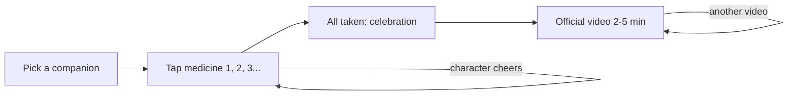

# TomarMedis 💊⭐

**TomarMedis** (short for *tomar medicinas*, "take medicines") is called **TakeMeds** in the English version.

A themed, configurable medicine routine for kids. Your child picks a favourite character, taps each medicine as they take it (the character cheers them on with a natural voice), and when the dose is complete they earn a short **official video** (2–5 minutes) from that show.

Built for an iPad on the kitchen counter, but it runs in any modern browser. [Versión en español](README.es.md).

**Try it:** https://tomarmedis.com (choose "Continue without code").

**How it was built:** in one afternoon, with Gemini in [Google Antigravity](https://antigravity.google/) and deployed on Google Cloud Run. The prompts to reproduce it step by step are in [PROMPTS.md](PROMPTS.md) ([en español](PROMPTS.es.md)).


## Features

- **6 themes**: PAW Patrol, SuperThings, Frozen, Toy Story, The Lion King and Wish, each with its own colours, fonts, animated background, sound effects, characters and lines (Spanish and English).
- **Character companions** with distinct, natural voices (Google Cloud Gemini-TTS), with the device voice as fallback.
- **Any routine**: 1–10 medicines (name, dose/size, how it's taken, colour, which doses) and any schedule: morning & night, once a day, every 12/8/6 hours or custom times. Doses after midnight count for the previous day.
- **Reward videos** from the franchises' official YouTube channels only (verified list + optional live search), 2–5 minutes, with "another video" and a per-dose limit for parents.
- **Week calendar** with progress and streaks, timestamps for every dose, undo for mistakes.
- **Parents zone** behind a grown-up check: settings, backup/restore (including backups from the original AI Studio version), setup links to configure another device.
- **Private by design**: all records stay on the device (localStorage). The server stores nothing.
- **Installable** (PWA): "Add to Home Screen" on iPad for a full-screen app that keeps its data.

## How it works



The web app is a React + Vite SPA. A small Node/Express server serves it and adds two optional APIs:

| Endpoint | What it does | Needs |
| --- | --- | --- |
| `POST /api/tts` | Natural voices via Cloud Text-to-Speech (Gemini-TTS, falls back to Chirp 3 HD). Cached in memory and on the device. | Google Cloud credentials (the Cloud Run service account) |
| `GET /api/videos` | Searches **only the official channels** for 2–5 minute embeddable videos, merges them with the verified list. Cached 12 h. | `YOUTUBE_API_KEY` (optional) |

Without them the app still works: it uses the device voice and the verified video list.

## Run locally

Requirements: Node.js 20+.

```bash
npm install
cp .env.example .env   # optional: set ACCESS_CODE, YOUTUBE_API_KEY, GOOGLE_CLOUD_PROJECT...
npm run dev            # http://localhost:3000
```

For natural voices locally, log in with `gcloud auth application-default login`, enable the Text-to-Speech API in a project and set `GOOGLE_CLOUD_PROJECT` in `.env`.

Other scripts: `npm run typecheck`, `npm run build`, `npm start` (serves the production build on port 8080).

## Deploy to Google Cloud Run

You need a Google Cloud project with billing enabled and the [gcloud CLI](https://cloud.google.com/sdk/docs/install).

```bash
gcloud auth login
PROJECT_ID=your-project-id ./deploy/deploy-cloud-run.sh
```

The script:

1. Enables Cloud Run, Cloud Build, Artifact Registry, Secret Manager, Text-to-Speech and YouTube Data APIs.
2. Creates a dedicated runtime service account.
3. Stores the **family access code** in Secret Manager (generates one if you don't pass `ACCESS_CODE`).
4. Optionally stores a YouTube API key (`YOUTUBE_API_KEY=...` or `CREATE_YOUTUBE_KEY=true`) and per-deployment theme overrides (`THEME_OVERRIDES_FILE=...`).
5. Builds the container with Cloud Build and deploys it (scale to zero, max 2 instances).

Useful variables: `REGION` (default `europe-west1`), `SERVICE` (default `med-heroes`), `TTS_MODEL` (default `gemini-2.5-flash-tts`), `PUBLIC=false` to require IAM authentication instead of a public URL.

> [!IMPORTANT]
> Keep the access code on for any public URL: it protects the paid APIs (voices) and your YouTube quota. Never commit keys or `.env` files; the repo's `.gitignore` and `.gcloudignore` already exclude them.

### Costs

Cloud Run scales to zero and usually stays within the free tier for one family. Voices are short and cached (each line is synthesized once), so Text-to-Speech costs are cents per month. The YouTube Data API is free within its daily quota.

## Using it on an iPad

1. Open the URL in Safari and type the family code once.
2. Tap **Share → Add to Home Screen**. The app opens full screen and Safari won't clear its data.
3. Parents zone (gear icon, grown-up check): set the child's name, theme, medicines and schedule. Use **Data → Setup link** to configure a second device in one tap.

## Configuration reference

All server settings are environment variables (see [.env.example](.env.example)):

| Variable | Default | Description |
| --- | --- | --- |
| `ACCESS_CODE` | _(off)_ | Family code required by the API endpoints. |
| `YOUTUBE_API_KEY` | _(off)_ | Enables live search in the official channels. Restrict it to the YouTube Data API v3. |
| `YOUTUBE_REGION` | `ES`/`US` | Region used to filter out videos that are blocked in your country. |
| `TTS_ENABLED` | `true` | Natural voices on/off. |
| `TTS_MODEL` | `gemini-2.5-flash-tts` | Gemini-TTS model (`gemini-2.5-pro-tts`, `gemini-3.1-flash-tts-preview`...). |
| `TTS_AUDIO_ENCODING` | `LINEAR16` | `LINEAR16` (WAV, full quality), `MP3` (smaller) or `OGG_OPUS`. |
| `THEME_OVERRIDES_JSON` / `THEME_OVERRIDES_FILE` | _(none)_ | Per-deployment tweaks: character images, names, extra videos or channels. See [deploy/theme-overrides.example.json](deploy/theme-overrides.example.json). |
| `CANONICAL_HOST` | _(none)_ | Your custom domain; `www.<domain>` is redirected to it. |

### Custom domain

1. Buy a domain at any registrar and verify it in [Search Console](https://search.google.com/search-console) with the same Google account that owns the Cloud Run project (`gcloud domains verify example.com`).
2. Map it: `gcloud beta run domain-mappings create --service med-heroes --domain example.com --region europe-west1` (and `www.example.com` if you want).
3. Add the DNS records printed by the command (A/AAAA for the root domain, CNAME `ghs.googlehosted.com` for subdomains). On Cloudflare keep them **DNS only** (grey cloud) so Google can issue the certificate.
4. Redeploy with `CANONICAL_HOST=example.com` so `www` redirects to the root domain.

Device data lives per web address, so after switching domains restore a backup (Parents zone → Data) or use a setup link.

## Characters, images and videos

This project does **not** include any official artwork. Characters show a friendly emoji avatar by default. You can add pictures:

- **Per device**: Parents zone → Theme → Character pictures (paste an image URL or upload a photo, for example of your child's toys).
- **Per deployment**: `THEME_OVERRIDES_JSON` with `themes.<theme>.characters.<id>.image` URLs (served only to authorised devices). Add `"fit": "contain"` for transparent renders; the default `"cover"` fills the round avatar.

Videos are embedded with the official YouTube player (privacy-enhanced mode) from the rights holders' channels listed in [shared/videoData.ts](shared/videoData.ts). Parents can add their own YouTube links per theme.

## Adding a theme

1. Create `src/themes/myTheme.ts` (palette, font, decoration, strings, characters with voice and lines). Copy an existing theme as a template.
2. Register it in `src/themes/index.ts` and add its id to `THEME_IDS` in `shared/catalog.ts`.
3. Add its official channels, search keywords and verified videos in `shared/catalog.ts` / `shared/videoData.ts`.

Voices are [Gemini-TTS voices](https://cloud.google.com/text-to-speech/docs/gemini-tts) (`Puck`, `Kore`, `Charon`...) plus a short style prompt per character.

## Project structure

```
server/           Express server: static app, /api/tts, /api/videos, access code, rate limits
shared/           Theme ids, official channels and verified videos (used by server and app)
src/themes/       The six themes: palette, characters, voices and lines (es/en)
src/components/   UI (medicine cards, picker, celebration + YouTube player, calendar, settings)
src/services/     Web Audio, speech (server voices + device fallback), videos, API client
src/state/        App state, storage, validation, backups and setup links
deploy/           Cloud Run deploy script and overrides example
```

## Disclaimer

TomarMedis (TakeMeds) is a reminder and motivation tool, not a medical device. Always follow your doctor's instructions.

This is an unofficial fan project, not affiliated with or endorsed by Disney, Pixar, Spin Master, Nickelodeon or Magic Box. All trademarks, characters and videos belong to their respective owners.

## License

[Apache 2.0](LICENSE)
