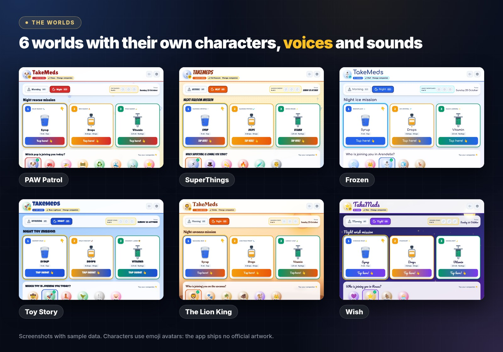
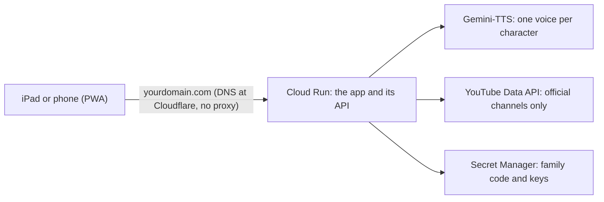
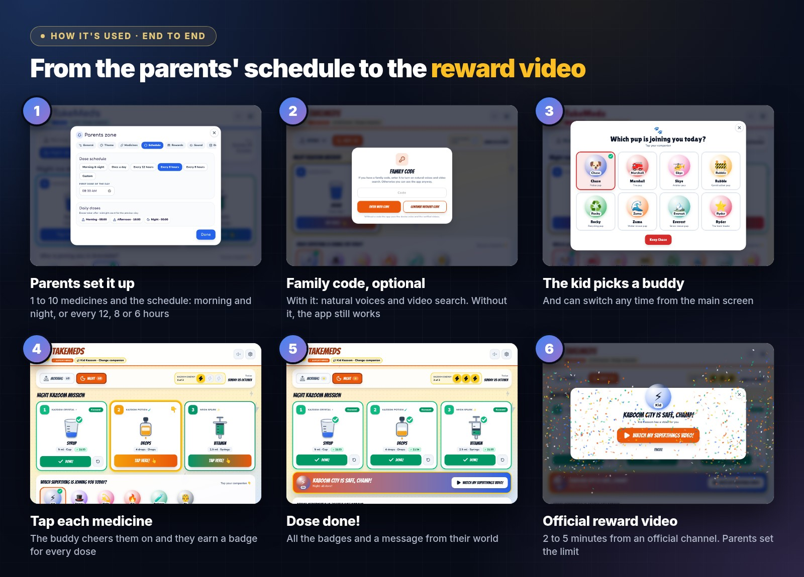
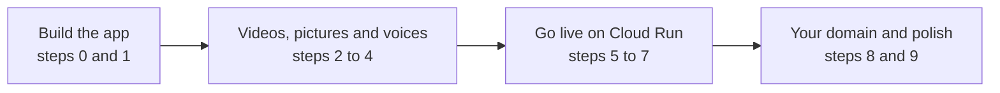

<p align="center">
  
</p>

<p align="center">
  🌐 <a href="https://tomarmedis.com"><b>Try it at tomarmedis.com</b></a> ·
  💬 <a href="PROMPTS.md"><b>All the prompts</b></a> ·
  🇪🇸 <a href="README.es.md">Español</a>
</p>

# How to build TomarMedis in one afternoon with Gemini in Antigravity

At home we've had to get used to medicines every morning and every night, and it's for the long haul. So one afternoon, the whole family built **TomarMedis** (*TakeMeds* in English) with **Gemini in [Google Antigravity](https://antigravity.google/)**. It's an app that turns taking medicine into a game, so the kid picks up the routine fast. We put it on **Google Cloud Run** and gave it its own domain with **Cloudflare**.

This repository **does not include the app's code**. It shows the process instead:
- what we asked the agent, in order;
- how we deployed it;
- how we connected the domain.

With it, you can build your own, with your family's favourite characters.

> [!TIP]
> In a hurry? Jump to [the afternoon, step by step](#the-afternoon) and copy the prompts from [PROMPTS.md](PROMPTS.md).

**Contents**

1. [What you'll build](#what-youll-build)
2. [How it's used](#how-its-used)
3. [What you need](#what-you-need)
4. [The afternoon, step by step](#the-afternoon)
5. [Your own domain with Cloudflare](#domain)
6. [Gotchas we hit](#gotchas)
7. [How to ask the agent](#tips)
8. [Disclaimer and license](#disclaimer)

<a id="what-youll-build"></a>

## 1. What you'll build

| | |
| --- | --- |
| **App type** | Installable web app (PWA). Designed for an iPad on the kitchen counter; runs in any modern browser |
| **Who it's for** | Kids aged 3 to 8, who tap, listen and win, and their parents, who set it up |
| **What it solves** | Every dose (morning and night, or every 12, 8 or 6 hours) becomes a mission with characters, voices and a reward video |
| **Languages** | Spanish and English |
| **Data** | Stays on the device: no accounts, no database |
| **What Gemini will generate** | React + Vite + TypeScript + Tailwind, a small Node/Express server and a Dockerfile |
| **On Google Cloud** | Cloud Run (scales to zero), Gemini-TTS for the voices, Secret Manager and Cloud Build. Optional: YouTube Data API |
| **Domain** | Bought at Cloudflare and connected with Cloud Run domain mapping |

<p align="center">
  
</p>

How it all fits together once it's live:



<a id="how-its-used"></a>

## 2. How it's used

<p align="center">
  
</p>

1. **Parents set it up** in the parents zone, behind a simple grown-up sum:
   - the child's name, language and world;
   - 1 to 10 medicines, each with its name, dose and how it's taken (cup, drops or syringe);
   - the schedule: morning and night, once a day, every 12, 8 or 6 hours, or custom times.
2. **Family code, optional.** With the code, natural voices and video search are switched on. With "Continue without code", the app uses the device voice and a list of already verified videos.
3. **The kid picks a buddy** and can switch any time from the main screen.
4. **They tap each medicine as they take it** ("Tap here!"). The buddy cheers them on with its own voice, and they earn a badge for every dose.
5. **Dose done:** a message from their world and a confetti celebration.
6. **Reward:** a 2 to 5 minute video from an official channel of their show. A "another video" button prefers the ones they haven't watched yet, and parents set the limit.

The app also has:
- a weekly calendar with streaks;
- undo for doses marked by mistake;
- backup and restore;
- a link that sets up another device in one tap.

<a id="what-you-need"></a>

## 3. What you need

- **[Google Antigravity](https://antigravity.google/)** with Gemini (we used Gemini 4).
- **A Google Cloud account** with billing enabled and a project.
  - Install the [gcloud CLI](https://cloud.google.com/sdk/docs/install) and run `gcloud auth login`.
  - The agent uses it from the terminal and asks for permission before every command.
- **Optional:** [Google AI Studio](https://aistudio.google.com/) for the first prototype.
- **Optional:** a YouTube Data API v3 key, to find new videos inside the official channels.
- **Optional:** a domain. We bought ours at Cloudflare; a .com costs around €10-15 a year.
- One afternoon (about 3 to 4 hours), and someone at home to try every change on the iPad 😉

<a id="the-afternoon"></a>

## 4. The afternoon, step by step



| Step | What you ask the agent | Approx. time | What you have at the end |
| --- | --- | --- | --- |
| [0](PROMPTS.md#step-0) | Quick prototype in AI Studio (optional) | 15 min | A first version to show at home |
| [1](PROMPTS.md#step-1) | Turn it into a real project | 45-60 min | The full app on your computer, with its worlds |
| [2](PROMPTS.md#step-2) | Official videos only | 20 min | Rewards from official channels, each video verified |
| [3](PROMPTS.md#step-3) | Character pictures without shipping artwork | 10 min | Emoji avatars, and photos only on your device |
| [4](PROMPTS.md#step-4) | Character voices with Gemini-TTS | 20 min | Every buddy with its own voice |
| [5](PROMPTS.md#step-5) | Deploy to Cloud Run | 20 min | A public URL with HTTPS |
| [6](PROMPTS.md#step-6) | A family code that doesn't get in the way | 10 min | The paid parts, protected |
| [7](PROMPTS.md#step-7) | Switch buddy any time | 10 min | The kid chooses who to play with |
| [8](PROMPTS.md#step-8) | Your own domain with Cloudflare | 30 min + wait | `yourdomain.com` with HTTPS |
| [9](PROMPTS.md#step-9) | Name and polish | 15 min | Ready for everyday use |

### 0. Quick prototype (optional)

In AI Studio, open **Build** and describe the app in your own words. It helps you show the idea at home and decide what you want before getting serious. Download the zip: you'll use it in step 1.

### 1. The real project in Antigravity

1. Open Antigravity in an empty local folder and attach the prototype zip.
2. Paste prompt 1 together with the [visual brief](PROMPTS.md#visual-brief), so the app gets the same look.
3. Ask for the plan first and review it.
4. Then let it build the app and test it by itself: typecheck, build, and screenshots from a headless browser in iPad landscape and portrait.

✅ Check that you can go through the whole journey: pick a buddy, tap the medicines and get to the reward.

### 2 to 4. Videos, pictures and voices

Three short prompts, one after the other:

- **Videos:** the agent finds each show's official channels and checks every video before adding it. New searches look only inside those channels, and we told it never to invent a video.
- **Pictures:** the app ships no official artwork. By default characters get emoji avatars. You add photos yourself, on your device or in your own deployment.
- **Voices:** every character gets a Gemini-TTS voice and a style prompt. Lines are cached, so they play instantly and you don't pay for them twice.

✅ Listen to the voices on a real iPad: Safari only plays audio after the first tap.

### 5. Deploy to Google Cloud Run

With prompt 5, the agent writes a deploy script and runs it in your project, asking permission for each command. This is what it does:

1. Enables the APIs: Cloud Run, Cloud Build, Artifact Registry, Secret Manager, Text-to-Speech and, if you use it, YouTube Data API.
2. Creates a service account just for the app, with `roles/aiplatform.user` (Gemini-TTS needs it) and access to its secrets.
3. Stores the family code, the YouTube key and the world settings in Secret Manager.
4. Builds and deploys with `gcloud run deploy --source`: scale to zero, at most 2 instances, public URL.
5. Tests the live URL: that it responds, that the code works, that it can generate a voice and that it finds videos.

✅ Open `https://<service>-<number>.<region>.run.app` on the iPad.

### 6 and 7. Family code and buddies

- **Family code:** a screen with two buttons of the same size, "Enter with code" and "Continue without code". It protects what costs money (voices and video search) without locking anyone out.
- **Buddies:** an always-visible row to switch character with one tap. The new one says hello.

### 8. Your domain

It's covered in detail in the [next section](#domain).

### 9. Name and polish

1. Name it in both languages (ours: TomarMedis and TakeMeds).
2. Review the texts with your kid.
3. Install it on the iPad from Safari with **Share → Add to Home Screen**. It then opens full screen and Safari doesn't clear its data.

<a id="domain"></a>

## 5. Your own domain with Cloudflare

This is what we did to get `tomarmedis.com`. You can do it by hand or ask the agent with [prompt 8](PROMPTS.md#step-8). Either way, you do the Cloudflare part yourself.

1. **Buy the domain** at Cloudflare: *Domain Registration → Register Domains*. Cloudflare runs its DNS from day one.
2. **Prove it's yours** with the Google account that owns the Cloud Run project:

   ```bash
   gcloud domains verify yourdomain.com
   ```

   Search Console opens. Choose DNS verification:
   - If Cloudflare is in the provider list, click **Start verification** and authorize it.
   - Otherwise, add a `TXT` record in Cloudflare with name `@` and the `google-site-verification=…` value.

   Then click **Verify**.

   > [!NOTE]
   > It doesn't matter which account you bought the domain with (we used a personal one). What matters is that the project's Google account is an **owner** in Search Console. If you already verified it with another account, add the project's account as an owner.

3. **Map the domain to the service**, plus `www` if you want it:

   ```bash
   gcloud beta run domain-mappings create --service <SERVICE> --domain yourdomain.com --region <REGION>
   gcloud beta run domain-mappings create --service <SERVICE> --domain www.yourdomain.com --region <REGION>
   ```

4. **Add the DNS records** shown by `gcloud beta run domain-mappings describe --domain yourdomain.com --region <REGION>`.
   - In Cloudflare, go to *DNS → Records → Add record*.
   - Set **Proxy status: DNS only** (grey cloud) and TTL Auto.

   We got these:

   | Type | Name | Content |
   | --- | --- | --- |
   | A (4 records) | `@` | `216.239.32.21`, `216.239.34.21`, `216.239.36.21`, `216.239.38.21` |
   | AAAA (4 records) | `@` | `2001:4860:4802:32::15`, `2001:4860:4802:34::15`, `2001:4860:4802:36::15`, `2001:4860:4802:38::15` |
   | CNAME | `www` | `ghs.googlehosted.com` |

   Keep the verification `TXT` record: Google checks it again from time to time.

5. **Wait for the HTTPS certificate.** Google issues it automatically, usually in under an hour and at most in 24 hours. Until then `https://yourdomain.com` may show a certificate error. That's expected.
6. **Redirect `www` to the root domain**, so the iPad always uses the same address. Ask the agent; we used a `CANONICAL_HOST` variable.
7. **Move the iPad to the new address.** Each web address keeps its own data. Back up on the old one (Parents zone → Data) and restore on the new one, or use the setup link.

> [!WARNING]
> If the records are left as **Proxied** (orange cloud), Google can't issue the certificate and the domain never works. It happened to us. Switching the 9 records to *DNS only* fixed it.

> [!NOTE]
> Cloud Run domain mapping is in *Preview* and only available in some regions (`europe-west1` is one of them). For a family app it's plenty. If your region doesn't have it, use a load balancer instead.

<a id="gotchas"></a>

## 6. Gotchas we hit

- **Gemini-TTS through Cloud Text-to-Speech** needs `aiplatform.endpoints.predict` on the service account (`roles/aiplatform.user`). Without it, the server silently falls back to another voice (Chirp 3 HD).
- **iPad Safari:**
  - unlock audio on the first tap;
  - use `playsinline` for YouTube;
  - add the app to the Home Screen so Safari doesn't clear its data.
- **YouTube:** many music videos refuse to play embedded even when oEmbed says they can. The player has to catch the error and skip to the next one.
- **Cloudflare:** records that point to Google must be *DNS only*, or the certificate never issues.
- **Changing domain:** data lives per web address, so back it up before you switch.
- **Firebase Hosting** in front of Cloud Run only forwards a cookie named `__session`. Cloud Run domain mapping doesn't have that limitation.

<a id="tips"></a>

## 7. How to ask the agent

- **Explain the problem the way you'd explain it to a person:** who uses it, what should happen and what shouldn't. Let the agent propose the how.
- **Plan first.** Ask for the plan, review it, then let it build.
- **One change per prompt.** It's easier to review and to undo.
- **Make it verify its own work** instead of trusting the summary:
  - typecheck and build;
  - iPad-sized screenshots from a headless browser;
  - once it's live, requests against the real URL.
- **No keys or real health data** in prompts or in the repository. The kid's name and medicines stay on the device.
- **Read the Google Cloud commands before approving them:** which APIs they enable, which permissions they grant and what becomes public.

<a id="disclaimer"></a>

## 8. Disclaimer and license

- TomarMedis (TakeMeds) is a reminder and motivation tool, **not a medical device**. Always follow your doctor's instructions.
- It's an unofficial fan project, not affiliated with or endorsed by Disney, Pixar, Spin Master, Nickelodeon or Magic Box. All trademarks, characters and videos belong to their owners.
- Videos are watched from their official channels through the YouTube player. Don't publish official artwork.
- The text and images in this guide are licensed under [CC BY 4.0](LICENSE).
